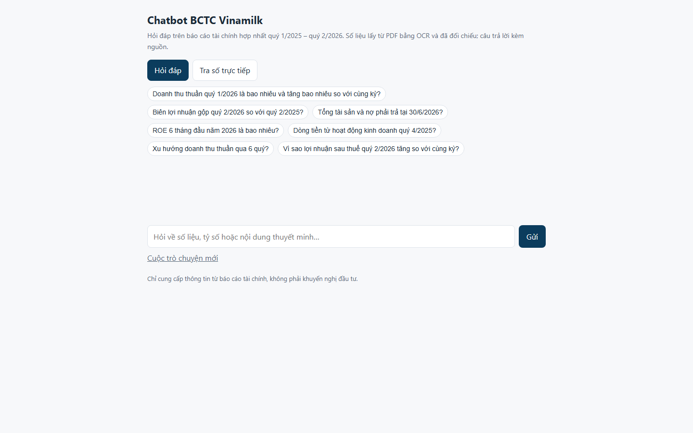
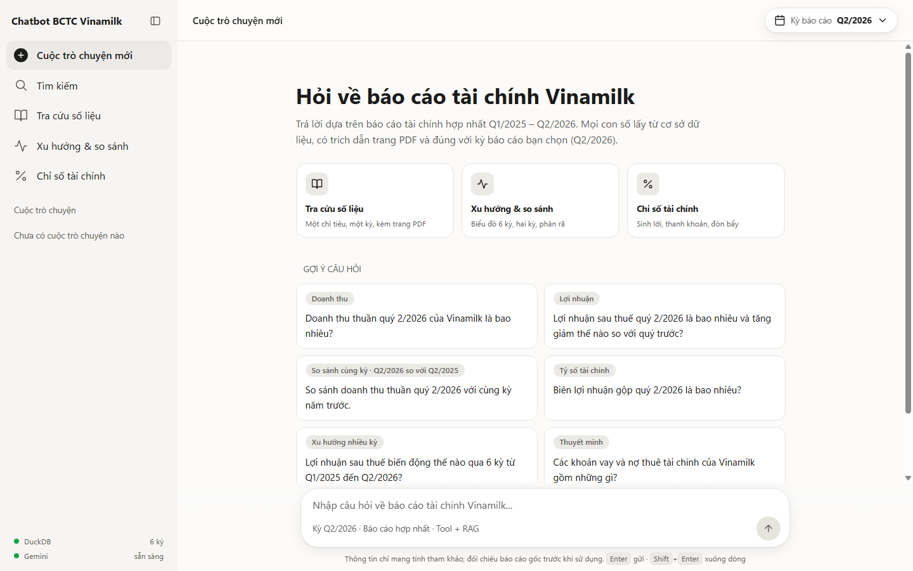
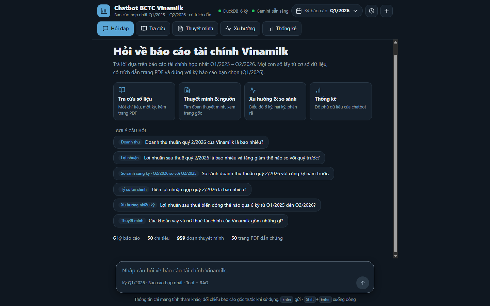
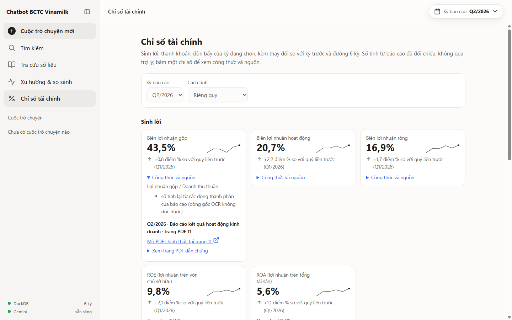
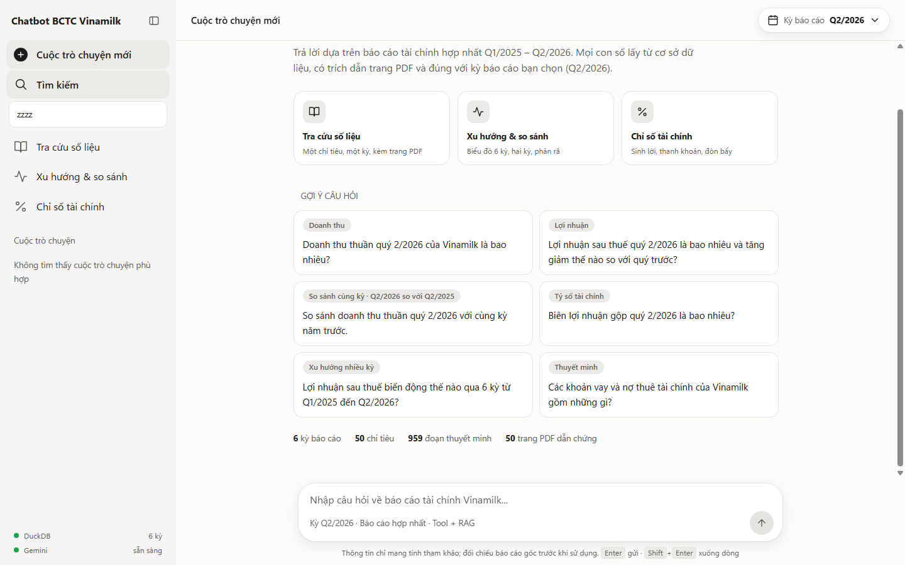
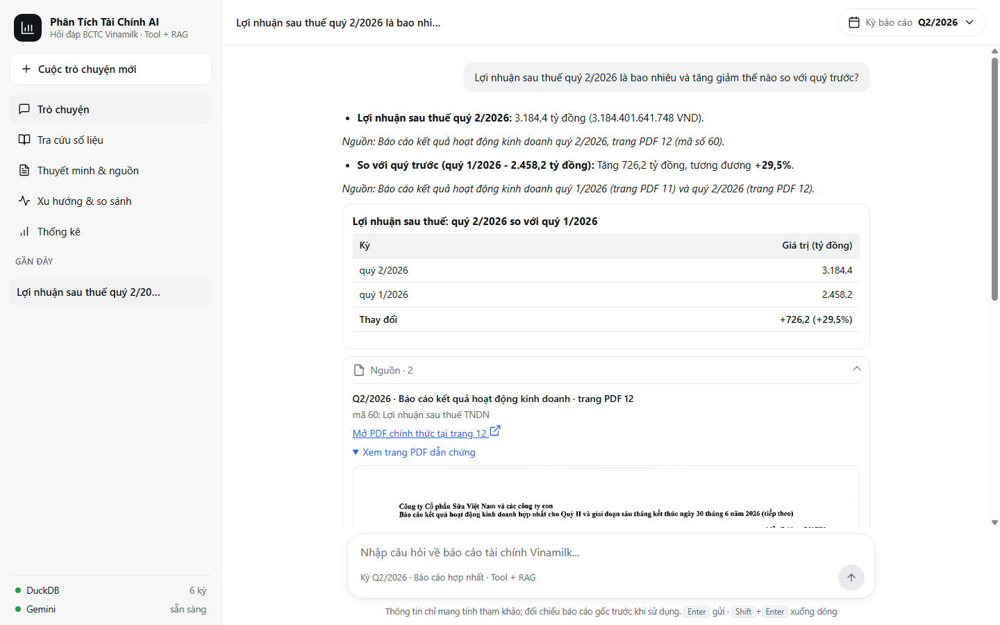
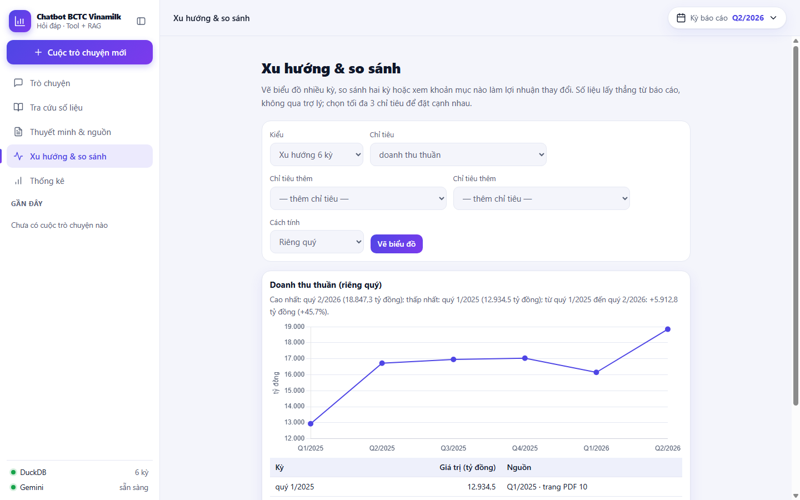
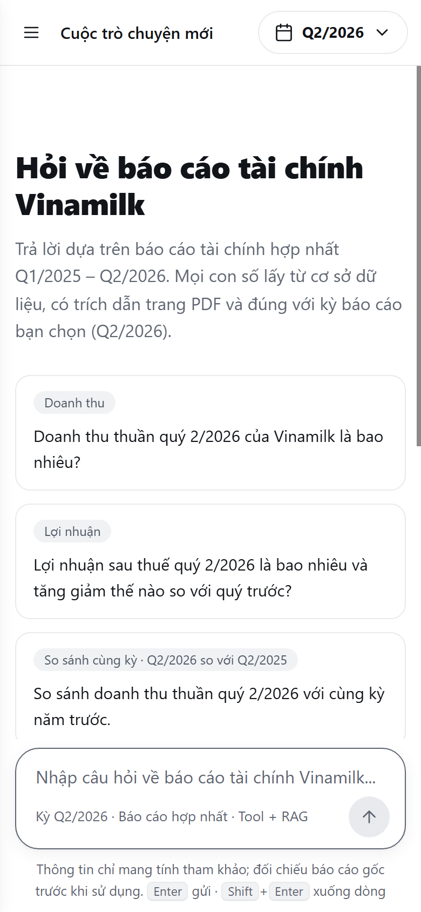
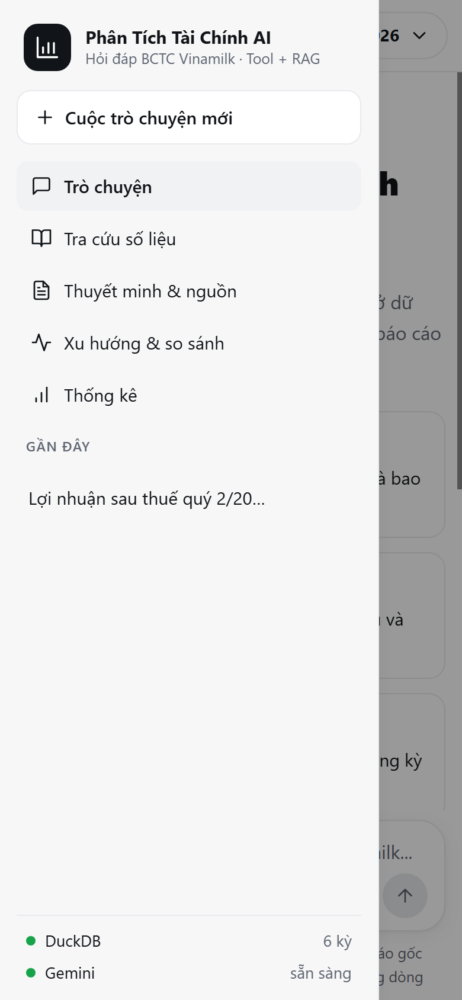
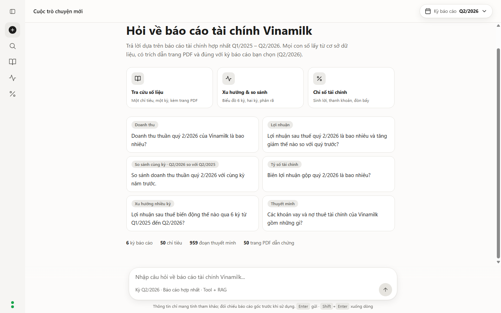

# duanNLP - Chatbot phân tích BCTC hợp nhất Vinamilk 2025-2026

Chatbot hỏi đáp trên báo cáo tài chính hợp nhất của Vinamilk (quý 1/2025 – quý 2/2026): tra số liệu, tính tỷ số và
tăng trưởng, vẽ xu hướng. Số liệu lấy từ PDF bằng OCR, đã đối chiếu thủ công; câu trả lời kèm nguồn
(báo cáo, trang PDF) và cảnh báo khi một con số không khớp kết quả công cụ.

| Thư mục | Nội dung |
|---|---|
| data/raw | PDF BCTC hợp nhất q1-2025 ... q2-2026 (không đưa lên git) |
| data/interim | kết quả OCR và parse trung gian (không đưa lên git) |
| data/processed | `financials.duckdb`, `chunks.jsonl`, `overrides.csv` (số đã đối chiếu tay với PDF) |
| src/ingest | pipeline dữ liệu: `preprocess.py` (PDF -> OCR), `parse_statements.py`, `repair_identities.py`, `build_db.py` |
| src/rag | `chunking.py`, truy xuất BM25 + mở rộng truy vấn theo biệt danh chỉ tiêu (`retriever.py`); nhánh vector n-gam chỉ giữ để đối chứng (đo: kém BM25, trọng số 0) |
| src/tools | tra số, tỷ số, tăng trưởng, chuỗi kỳ, phân rã biến động (`explain.py`), máy tính (`TOOL_SPECS`, `call_tool`) |
| src/ratios.py, src/stats.py | bảng chỉ số tài chính (mục Chỉ số tài chính) và số đếm độ phủ dữ liệu (hàng số liệu ở màn hình chào), đều không qua mô hình |
| src/web | lớp web dùng chung: giới hạn tốc độ, liên kết nguồn (PDF chính thức, ảnh trang), kiểu dữ liệu vào |
| src/agent | agent Gemini function-calling gọi công cụ + retriever; kiểm tra số bám nguồn (`guard.py`); dựng dữ liệu biểu đồ/bảng từ kết quả công cụ (`charts.py`) |
| src/feedback.py | lưu phản hồi 👍/👎 qua giao diện `FeedbackStore` (mặc định ghi log, tùy chọn webhook) |
| src/train | huấn luyện: bộ phân loại ý định câu hỏi (`train_intent.py`) và tìm lưới tham số truy xuất (`tune_retrieval.py`) |
| api, public | API FastAPI (`api/index.py`, chỉ còn định tuyến) và giao diện tĩnh: `public/index.html` (khung), `public/css/app.css`, `public/js/` (module ES), ảnh trang PDF dẫn chứng (`public/pages`) |
| tests, eval | kiểm thử; `eval/retrieval_check.py` (truy xuất), `eval/e2e_eval.py` + `eval/golden.jsonl` (đánh giá đầu-cuối với Gemini thật) |

## Tính năng

- **Hỏi đáp có dẫn chứng:** câu trả lời kèm nguồn (báo cáo, trang PDF, ảnh trang có khung đánh dấu dòng) và cảnh báo số không khớp.
- **Biểu đồ xu hướng và bảng so sánh kỳ:** khi câu hỏi dẫn tới `get_series` (xu hướng nhiều kỳ) hoặc `get_growth` (so sánh hai kỳ),
  `/api/ask` trả thêm trường `charts` (kỳ, giá trị VND, đơn vị, nguồn) dựng từ kết quả công cụ, không từ lời mô hình.
  Giao diện vẽ đường bằng Chart.js 4.4.7 (đóng gói trong `public/js/vendor`, kiểm tra SRI, nạp khi cần) kèm bảng số liệu; câu hỏi một kỳ không có biểu đồ.
- **Giải thích biến động (`explain_change`):** phân rã chênh lệch lợi nhuận sau thuế hoặc doanh thu thuần giữa hai kỳ (so với cùng kỳ
  năm trước hoặc quý liền trước) theo các khoản mục báo cáo KQKD; tổng đóng góp bằng đúng chênh lệch. Mô hình chỉ diễn giải, không suy đoán nguyên nhân kinh doanh.
- **Hỏi lại khi câu mơ hồ (`src/agent/clarify.py`):** chạy trước Gemini nên không tốn lượt gọi mô hình. Hỏi lại khi (1) chỉ tiêu chung chung ("lợi nhuận", "phải thu", "nợ", "tài sản", "dòng tiền", "vốn") mà không nói loại,
  hoặc (2) có chỉ tiêu nhưng không nêu kỳ và hội thoại trước cũng chưa nêu kỳ. Trả về trường `clarify` (câu hỏi + các lựa chọn, mỗi lựa chọn là câu hỏi đầy đủ) và giao diện hiện nút bấm. Không hỏi với câu nhiều kỳ, tỷ số, "vì sao", thuyết minh,
  dự báo hay công ty khác. Đo trên 132 câu của golden và validation: 0 câu bị hỏi nhầm. Mặc định tắt trong `VinamilkAgent` (đánh giá `e2e_eval` không đổi); API bật.
- **Mọi trích dẫn đều có bằng chứng:** "trang PDF N" trong thẻ Nguồn là liên kết mở PDF chính thức đúng trang (Q1, Q2/2026) hoặc ảnh trang. Trang thuyết minh chưa có ảnh thì hiện trích đoạn văn bản OCR của đúng trang đó (`excerpt`).
  Các kỳ 2025 chưa có liên kết PDF chính thức trong mã nên chỉ có ảnh trang hoặc trích đoạn; muốn có ảnh mọi trang cần chạy lại `src/ingest/render_pages.py` ở máy có `data/raw`.
- **Phản hồi 👍/👎:** nút dưới mỗi câu trả lời gửi `POST /api/feedback` với `{question, answer, label: "up"|"down", timestamp?}`.
  Không lưu IP hay dữ liệu cá nhân. Mặc định mỗi phản hồi là một dòng `FEEDBACK {...}` trong Vercel Logs; đặt `FEEDBACK_WEBHOOK_URL`
  (và tùy chọn `FEEDBACK_WEBHOOK_TOKEN`) để gửi sang dịch vụ lưu trữ riêng; `FEEDBACK_LIMIT_PER_MINUTE` (mặc định 20) giới hạn tốc độ gửi.

## Giao diện

Giao diện tĩnh (HTML + CSS + module ES thuần, không bước build), thanh bên đơn giản kiểu Copilot: **Cuộc trò chuyện mới** và **Tìm kiếm** (lọc các cuộc trò chuyện đã lưu, gõ không dấu vẫn tìm được),
cùng ba chức năng hay dùng nhất: **Tra cứu số liệu**, **Xu hướng & so sánh**, **Chỉ số tài chính**; bên dưới là danh sách "Cuộc trò chuyện" (đổi tên/xóa, lưu trong `localStorage`) và hai chấm DuckDB/Gemini
từ `/api/health`. Thanh bên thu gọn được thành thanh biểu tượng (nhớ lựa chọn). Vùng nội dung có chọn kỳ báo cáo, màn hình chào với 3 lối tắt chức năng, 6 câu gợi ý và hàng số liệu thật.
Phím tắt: `Ctrl/Cmd+K` tìm kiếm, `/` vào ô nhập. Tông xanh chàm, điểm nhấn xanh ngọc/tím; nút Sáng/Tối ở cuối thanh bên trái nhớ lựa chọn. Khi chưa chọn, giao diện theo hệ thống. Thanh bên thành ngăn kéo dưới 900 px. Biểu đồ đổi màu cùng giao diện.

|  |  |  |

| Chỉ số tài chính | Tìm kiếm cuộc trò chuyện |
|---|---|
|  |  |

| Trả lời kèm nguồn | Xu hướng & so sánh |
|---|---|
|  |  |

| Điện thoại | Ngăn kéo | Thanh bên thu gọn |
|---|---|---|
|  |  |  |

## Chạy chatbot

### Thành viên nhóm: chạy cùng phiên bản

Bản giao diện hiện tại ở nhánh `main`. Dùng Python 3.13 và các phiên bản thư viện trong `requirements.txt`.

```powershell
git clone --branch main https://github.com/quanle205/chatbot_Vinamilk.git
cd chatbot_Vinamilk
python -m venv .venv
.\.venv\Scripts\Activate.ps1
python -m pip install -r requirements.txt
Copy-Item .streamlit/secrets.example.toml .streamlit/secrets.toml
# Mở secrets.toml, thay PASTE_YOUR_OWN_KEY_HERE bằng key của bạn.
.\chay.bat
```

Nếu đã có repo: chuyển sang `main`, chạy `git pull --ff-only origin main` và cài lại `requirements.txt` trong môi trường ảo. Nếu có thay đổi chưa lưu, commit hoặc stash trước khi chuyển nhánh. Dữ liệu DuckDB, các đoạn truy xuất và ảnh dẫn chứng đã có trong repo; không cần chạy OCR lại.

### Thành viên nhóm: triển khai Vercel

1. Import repository này vào Vercel (hoặc fork nếu tài khoản không được phép import).
2. Chọn nhánh triển khai **main**. Trong Settings → Git, đặt **Production Branch** là `main`; nhánh mặc định khác có thể chứa giao diện cũ.
3. Root Directory là thư mục gốc repo. Framework Preset: **Other**. Giữ Build Command và Output Directory ở mặc định, không nhập `public` làm Root Directory.
4. Trong Environment Variables, thêm `GEMINI_API_KEY` bằng key riêng, không có dấu ngoặc kép; áp dụng cho Production và Preview nếu dùng.
5. Nếu cần chọn mô hình, thêm `GEMINI_MODEL` và `GEMINI_FALLBACK_MODELS` (danh sách phân cách bằng dấu phẩy) theo các tên khả dụng với key. Mặc định hiện tại xem `src/agent/agent.py`; key mới không bảo đảm có quyền dùng mọi mô hình.
6. Deploy. Sau khi sửa key hoặc biến môi trường, **Redeploy** để áp dụng. `secrets.toml` không được đưa lên GitHub và không được Vercel đọc.
7. Mở `/api/health`: cần `ok: true`, `periods: 6`, `gemini_key: true`. Trường `gemini_key` chỉ kiểm tra có cấu hình key, không xác minh key hợp lệ. Thử thêm một câu hỏi để kiểm tra Gemini.

Mã nguồn, dữ liệu và giao diện sẽ giống nhau khi dùng cùng commit. Lịch sử trò chuyện, chế độ sáng/tối được lưu riêng trong từng trình duyệt; câu trả lời AI còn phụ thuộc key, mô hình và hạn mức.

Kiểm tra UI tự động: cài Playwright trong môi trường kiểm thử, có Microsoft Edge, chạy server rồi `node tests/ui_smoke.cjs` (mặc định `http://127.0.0.1:8017`, đổi bằng `UI_TEST_URL`). Test dùng API dữ liệu thật và phản hồi Gemini giả lập.

Triển khai trên Vercel: import repo, Framework **Other** (không đổi Build Command), đặt biến môi trường `GEMINI_API_KEY`
(khóa Gemini miễn phí tại aistudio.google.com/apikey; tùy chọn `GEMINI_MODEL`, mặc định `gemini-3.8-flash`). Không commit khóa lên git.
`vercel.json` giới hạn thời gian chạy 60 giây và chỉ đóng gói `src/`, `data/processed/` và `public/pages/`.
Các bộ giới hạn tốc độ (xem bên dưới) nằm trong bộ nhớ của từng phiên bản hàm nên chỉ là lớp bảo vệ cơ bản.

Chạy trên máy (Windows): `.\chay.bat` (hoặc `powershell -File .\chay.ps1`). Script tự nạp khóa Gemini từ biến môi trường, `.env` hoặc `.streamlit\secrets.toml` (đều nằm trong `.gitignore`), cài thư viện nếu thiếu, chạy server và mở http://localhost:8000; đổi cổng bằng `-Port 8001`. Chạy tay:

```
pip install -r requirements.txt uvicorn
set GEMINI_API_KEY=khoa-cua-ban
python -m uvicorn api.index:app --port 8000
```

Không có khóa thì mục Trò chuyện báo "chưa sẵn sàng", các mục Tra cứu, Xu hướng, Chỉ số tài chính vẫn dùng được. Giới hạn mỗi phút theo IP: `RATE_LIMIT_PER_MINUTE` (hỏi đáp, mặc định 6), `BROWSE_LIMIT_PER_MINUTE` (tra cứu, thuyết minh, biểu đồ; mặc định 30), `FEEDBACK_LIMIT_PER_MINUTE` (mặc định 20).

## Kiểm thử

```
python tests/test_tools.py
python tests/test_agent.py
python tests/test_api.py           # cần pip install httpx
python eval/retrieval_check.py
```

Các test không gọi mạng (Gemini được thay bằng client giả). `python tests/test_e2e_scoring.py` kiểm tra bộ chấm điểm đầu-cuối và bộ câu vàng.

### Kiểm định dữ liệu (không cần mạng)

```
python eval/data_audit.py --sensitivity 150 --sample 40
python tests/test_data_audit.py
```

Áp đẳng thức kế toán (tổng tài sản = nợ + vốn, doanh thu thuần − giá vốn = lợi nhuận gộp, ...), kiểm tra chéo giữa báo cáo (số 1/1/2025 như nhau ở mọi báo cáo 2025, quý 1 + quý 2 = lũy kế 6 tháng)
và toàn bộ ràng buộc dòng tổng/dòng con của pipeline lên DB cuối cùng. Kết quả: **638/638 đạt, 1.696/1.716 ô (99%) được ít nhất một ràng buộc phủ**, và mọi lỗi một chữ số chèn giả đều bị bắt.
Hiểu đúng giới hạn: đây là kiểm tra **nhất quán nội bộ**, không phải đối chiếu với PDF. Pipeline sửa OCR đã dùng chính các ràng buộc này nên 71 ô đã sửa/suy ra (REPAIRED/DERIVED) đạt theo cách dựng;
bằng chứng mạnh là 1.542 ô OCR thuần đều thỏa mọi ràng buộc, vì một chữ số sai gần như chắc chắn làm vỡ đẳng thức. Lỗi không bị bắt: sai ở ô nằm ngoài ràng buộc (19 ô,
xuất ra `eval/reports/ocr_sample.csv` để đối chiếu tay), hoặc hai lỗi bù trừ nhau. Đã đối chiếu tay với PDF 18 trong 19 ô chưa được phủ (ô còn lại trùng giá trị với một ô đã kiểm): **0 ô sai**. Với 18 ô, 0 sai chỉ cho biết tỷ lệ sai tối đa khoảng 15% (CI95), nên đây là xác nhận nhỏ,
không phải ước lượng tỷ lệ sai OCR chung; ước lượng đó vẫn cần người đối chiếu một mẫu ngẫu nhiên các ô OCR đã được phủ (xuất bằng `--sample` sau khi bỏ lọc ô chưa phủ).

### Đánh giá đầu-cuối với Gemini thật

```
python eval/build_golden.py                  # dựng lại eval/golden.jsonl (86 câu; đáp án lấy từ DuckDB đã đối chiếu tay)
python eval/e2e_eval.py --limit 10           # thử nhanh
python eval/e2e_eval.py --sleep 4            # toàn bộ; khóa miễn phí có hạn mức nên nghỉ giữa các câu
```

Độ đo: chọn đúng công cụ và tham số, đúng số liệu, đúng nguồn, truy xuất đúng đoạn thuyết minh, từ chối đúng câu ngoài phạm vi,
không bịa số khi thiếu dữ liệu, tỷ lệ hallucination (số bị `guard.py` gắn cờ), từ chối nhầm câu hợp lệ, độ trễ p50/p95, token;
kèm khoảng tin cậy Wilson 95%. Câu lỗi mạng/hạn mức (429) bị loại khỏi tỷ lệ và đếm riêng. Báo cáo JSON (có câu trả lời từng câu) ở `eval/reports/` (không đưa lên git).
Tập kiểm chứng độc lập `eval/validation.jsonl` (46 câu, dựng bằng `eval/build_validation.py`, chạy `--golden eval/validation.jsonl`) viết sau golden với chỉ tiêu/kỳ/cách nói khác; quy tắc: không sửa mã dựa trên nó rồi chấm lại chính nó.
Kết quả kiểm chứng độc lập (46 câu, chạy một lần, không chỉnh mã theo kết quả): **45/46 = 98%** (CI95 89–100%), hallucination 0/46, từ chối nhầm 0/33, từ chối đúng 10/10;
cũng do mô hình dự phòng `gemini-3.5-flash-lite` trả lời. Câu sai duy nhất: "phải thu của khách hàng" bị khớp mờ sang tổng phải thu ngắn hạn. Đã bổ sung biệt danh, quy tắc prompt và test, chưa chấm lại.
Chạy lại với `--model gemini-3.6-flash` (không có `--no-fallback`) vẫn do `gemini-3.5-flash-lite` trả lời 38/38 câu, vì mô hình chỉ định lỗi rồi bị thay âm thầm: kết quả 43/45 không phải số của `3.6`.
Dùng `--no-fallback` khi muốn đo đúng một mô hình. Hai câu sai (khấu hao, cổ tức) cùng kiểu: mô hình nhỏ dùng `search_documents` thay `get_metric` và nêu số từ một bảng thuyết minh khác định nghĩa.
Chú ý: "hallucination = 0" chỉ nghĩa là mọi số đều lấy từ công cụ; nó không bắt được trường hợp công cụ trả số của chỉ tiêu khác.
Lưu ý: golden set đo hành vi của agent so với dữ liệu đã đối chiếu, không đo độ đúng của OCR.

**Kết quả đo gần nhất (86 câu, Gemini thật, 2026-11-08):**
lượt đầu 80/86 đạt (93%, CI95 86–97%) sau khi loại 20 lỗi hạn mức 429 và chạy lại; sau khi sửa các lỗi tìm thấy rồi chạy lại 6 câu sai: 85/86.
Hallucination 0/86, từ chối nhầm 0/68, từ chối đúng 14/14. Cần đọc kèm:
- **Gần như toàn bộ câu do mô hình dự phòng `gemini-3.5-flash-lite` trả lời** (68/74; mô hình chính chỉ 2 câu) vì hạn mức khóa miễn phí. Số trên phản ánh mô hình yếu nhất; chạy lại với khóa có hạn mức đủ cho mô hình chính.
- Các sửa (biệt danh chỉ tiêu, cảnh báo khớp mờ, nhắc lại khi mô hình nói sai "không có dữ liệu", quy tắc "so với đầu năm", nới tiêu chí xu hướng) được rút ra từ chính 86 câu này nên 85/86 là số đã tinh chỉnh trên tập dev, không phải số kiểm chứng độc lập. Cần thêm câu mới chưa dùng để sửa.
- Mô hình không xác định (cùng câu có lúc đúng, lúc sai) nên mỗi lần chạy có thể lệch vài câu. Chất lượng nhận xét xu hướng bằng lời (ví dụ "tăng ổn định" dù Q4/2025 giảm) chưa chấm tự động.

## Huấn luyện và đo

```
python -m src.train.train_intent       # phân loại ý định: train 1.656 / test 390 câu + 244 câu giữ lại sạch; quét ngưỡng từ chối
python -m src.train.tune_retrieval     # tìm lưới k1, b, trọng số vector trên 210 câu train / 90 câu test (~4 phút)
```

Bộ phân loại huấn luyện lại dưới 1 giây mỗi lần khởi động ứng dụng (không lưu tệp mô hình) và chỉ dùng để từ chối sớm câu ngoài phạm vi (ngưỡng 0,8).
Tham số BM25 hiện dùng (k1 = 0,9; b = 0,5; trọng số vector 0) là kết quả của bước tìm lưới.

## Chạy lại pipeline dữ liệu

```
pip install -r requirements-pipeline.txt        # cần thêm Tesseract (có gói tiếng Việt) và poppler
python src/ingest/preprocess.py --input data/raw --output data/interim
python src/ingest/parse_statements.py --pages-dir data/interim --output data/interim
python src/ingest/repair_identities.py --parse-dir src/ingest --csv data/interim/statements_long.csv --out data/interim --overrides data/processed/overrides.csv
python src/ingest/build_db.py
python -m src.rag.chunking
python src/ingest/render_pages.py   # ảnh các trang PDF được trích dẫn -> public/pages (dẫn chứng bên cạnh câu trả lời)
python src/ingest/locate_rows.py    # vị trí từng dòng số liệu trên ảnh trang (khung đỏ đánh dấu dòng được trích)
## Cách chạy code khi tải từ github xuống hãy chạy theo code sau: 
git clone https://github.com/quanle205/chatbot_Vinamilk.git
cd chatbot_Vinamilk
git checkout feature/redesign-ui
python -m venv .venv
.venv\Scripts\activate
pip install -r requirements.txt
## lấy key trên Gemini key rồi dán vào secrets.toml
```
