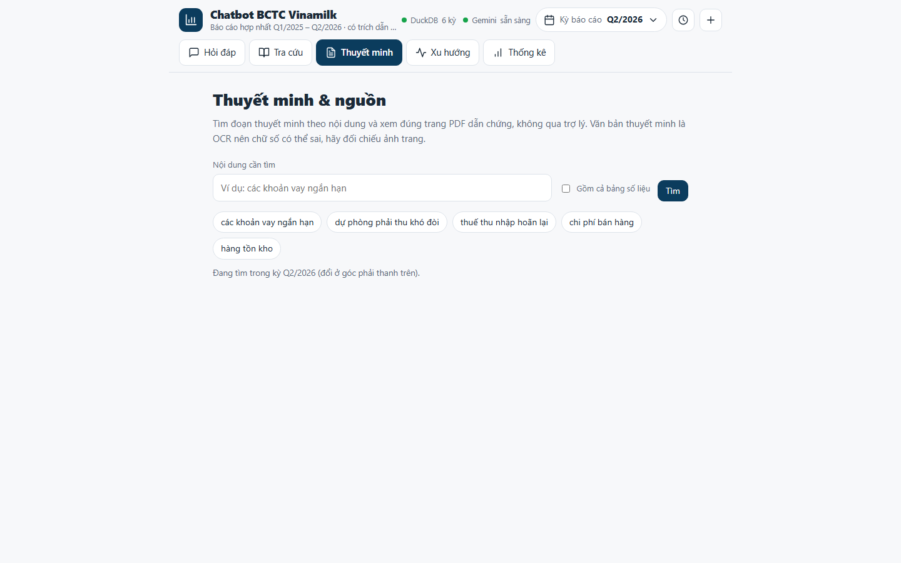
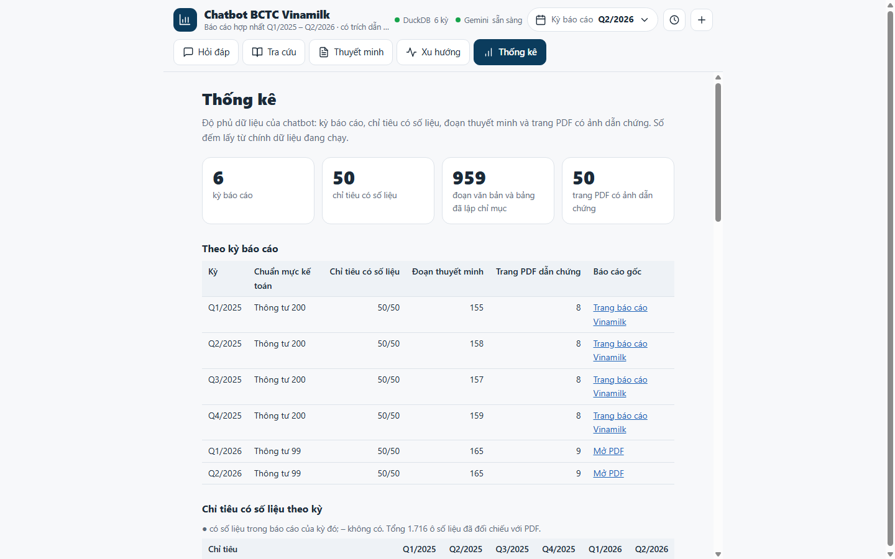
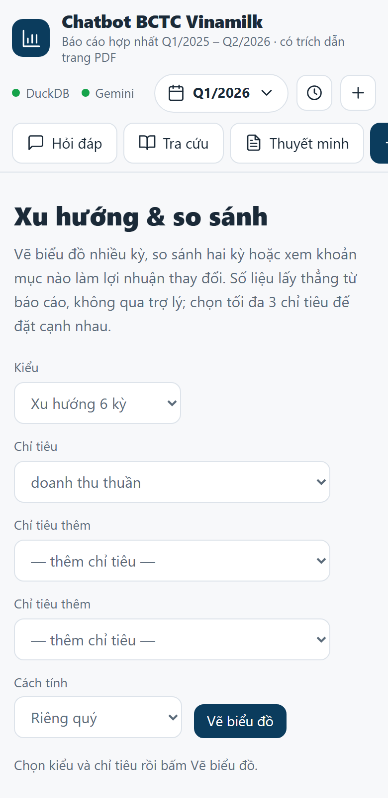

# duanNLP - Chatbot phân tích BCTC hợp nhất Vinamilk 2025-2026

Chatbot hỏi đáp trên báo cáo tài chính hợp nhất của Vinamilk (quý 1/2025 – quý 2/2026): tra số liệu, tính tỷ số và
tăng trưởng, tìm nội dung thuyết minh. Số liệu lấy từ PDF bằng OCR, đã đối chiếu thủ công; câu trả lời kèm nguồn
(báo cáo, trang PDF) và cảnh báo khi một con số không khớp kết quả công cụ.

| Thư mục | Nội dung |
|---|---|
| data/raw | PDF BCTC hợp nhất q1-2025 ... q2-2026 (không đưa lên git) |
| data/interim | kết quả OCR và parse trung gian (không đưa lên git) |
| data/processed | `financials.duckdb`, `chunks.jsonl`, `overrides.csv` (số đã đối chiếu tay với PDF) |
| src/ingest | pipeline dữ liệu: `preprocess.py` (PDF -> OCR), `parse_statements.py`, `repair_identities.py`, `build_db.py` |
| src/rag | `chunking.py`, BM25 + vector n-gam + RRF (`retriever.py`) |
| src/tools | tra số, tỷ số, tăng trưởng, chuỗi kỳ, phân rã biến động (`explain.py`), máy tính (`TOOL_SPECS`, `call_tool`) |
| src/notes.py, src/stats.py | tìm đoạn thuyết minh (mục Thuyết minh & nguồn) và thống kê độ phủ dữ liệu (mục Thống kê), đều không qua mô hình |
| src/web | lớp web dùng chung: giới hạn tốc độ, liên kết nguồn (PDF chính thức, ảnh trang), kiểu dữ liệu vào |
| src/agent | agent Gemini function-calling gọi công cụ + retriever; kiểm tra số bám nguồn (`guard.py`); dựng dữ liệu biểu đồ/bảng từ kết quả công cụ (`charts.py`) |
| src/feedback.py | lưu phản hồi 👍/👎 qua giao diện `FeedbackStore` (mặc định ghi log, tùy chọn webhook) |
| src/train | huấn luyện: bộ phân loại ý định câu hỏi (`train_intent.py`) và tìm lưới tham số truy xuất (`tune_retrieval.py`) |
| api, public | API FastAPI (`api/index.py`, chỉ còn định tuyến) và giao diện tĩnh: `public/index.html` (khung), `public/css/app.css`, `public/js/` (module ES), ảnh trang PDF dẫn chứng (`public/pages`) |
| tests, eval | kiểm thử và đo chất lượng truy xuất |

## Tính năng

- **Hỏi đáp có dẫn chứng:** câu trả lời kèm nguồn (báo cáo, trang PDF, ảnh trang có khung đánh dấu dòng) và cảnh báo số không khớp.
- **Biểu đồ xu hướng và bảng so sánh kỳ:** khi câu hỏi dẫn tới `get_series` (xu hướng nhiều kỳ) hoặc `get_growth` (so sánh hai kỳ),
  `/api/ask` trả thêm trường `charts` (kỳ, giá trị VND, đơn vị, nguồn) dựng từ kết quả công cụ, không từ lời mô hình.
  Giao diện vẽ cột bằng Chart.js 4.4.7 (nạp từ CDN, ghim phiên bản và SRI, chỉ khi cần) kèm bảng số liệu; câu hỏi một kỳ không có biểu đồ.
- **Giải thích biến động (`explain_change`):** phân rã chênh lệch lợi nhuận sau thuế hoặc doanh thu thuần giữa hai kỳ (so với cùng kỳ
  năm trước hoặc quý liền trước) theo các khoản mục báo cáo KQKD; tổng đóng góp bằng đúng chênh lệch. Mô hình chỉ diễn giải, không suy đoán nguyên nhân kinh doanh.
- **Phản hồi 👍/👎:** nút dưới mỗi câu trả lời gửi `POST /api/feedback` với `{question, answer, label: "up"|"down", timestamp?}`.
  Không lưu IP hay dữ liệu cá nhân. Mặc định mỗi phản hồi là một dòng `FEEDBACK {...}` trong Vercel Logs; đặt `FEEDBACK_WEBHOOK_URL`
  (và tùy chọn `FEEDBACK_WEBHOOK_TOKEN`) để gửi sang dịch vụ lưu trữ riêng; `FEEDBACK_LIMIT_PER_MINUTE` (mặc định 20) giới hạn tốc độ gửi.

## Giao diện

Giao diện tĩnh (HTML + CSS + module ES thuần, không bước build), một cột như bản cũ: đầu trang (tên, chỉ báo DuckDB/Gemini từ `/api/health`, chọn kỳ báo cáo,
hộp "Gần đây" lưu trong `localStorage` có đổi tên/xóa, nút cuộc trò chuyện mới), thanh 5 thẻ chức năng (Hỏi đáp, Tra cứu, Thuyết minh, Xu hướng, Thống kê)
luôn thấy, và nội dung bên dưới. Màn hình chào có 4 lối tắt tới các chức năng và 6 câu gợi ý. Có chế độ tối theo hệ thống, thẻ cuộn ngang trên điện thoại.

|  |  |  |

| Trả lời kèm nguồn | Thuyết minh & nguồn |
|---|---|
|  |  |

| Xu hướng & so sánh | Thống kê |
|---|---|
|  |  |

| Điện thoại: Hỏi đáp | Điện thoại: Xu hướng |
|---|---|
|  |  |

## Chạy chatbot

Triển khai trên Vercel: import repo, Framework **Other** (không đổi Build Command), đặt biến môi trường `GEMINI_API_KEY`
(khóa Gemini miễn phí tại aistudio.google.com/apikey; tùy chọn `GEMINI_MODEL`, mặc định `gemini-3.8-flash`). Không commit khóa lên git.
`vercel.json` giới hạn thời gian chạy 60 giây và chỉ đóng gói `src/`, `data/processed/` và `public/pages/`.
Các bộ giới hạn tốc độ (xem bên dưới) nằm trong bộ nhớ của từng phiên bản hàm nên chỉ là lớp bảo vệ cơ bản.

Chạy trên máy (Windows): `.\chay.bat` (hoặc `powershell -File .\chay.ps1`). Script tự nạp khóa Gemini từ biến môi trường, `.env` hoặc `.streamlit\secrets.toml` (đều nằm trong `.gitignore`), cài thư viện nếu thiếu, chạy server và mở http://localhost:8000; đổi cổng bằng `-Port 8001`. Chạy tay:

```
pip install -r requirements.txt uvicorn
set GEMINI_API_KEY=khoa-cua-ban
python -m uvicorn api.index:app --port 8000
```

Không có khóa thì mục Trò chuyện báo "chưa sẵn sàng", bốn mục còn lại vẫn dùng được. Giới hạn mỗi phút theo IP: `RATE_LIMIT_PER_MINUTE` (hỏi đáp, mặc định 6), `BROWSE_LIMIT_PER_MINUTE` (tra cứu, thuyết minh, biểu đồ; mặc định 30), `FEEDBACK_LIMIT_PER_MINUTE` (mặc định 20).

## Kiểm thử

```
python tests/test_tools.py
python tests/test_agent.py
python tests/test_api.py           # cần pip install httpx
python eval/retrieval_check.py
```

Các test không gọi mạng (Gemini được thay bằng client giả); chất lượng câu trả lời thật chưa được đo.

## Huấn luyện và đo

```
python -m src.train.train_intent       # phân loại ý định: train 1.044 / test 390 câu, độ chính xác ~0,80, quét ngưỡng từ chối
python -m src.train.tune_retrieval     # tìm lưới k1, b, trọng số vector trên 210 câu train / 90 câu test (~4 phút)
```

Bộ phân loại huấn luyện lại dưới 1 giây mỗi lần khởi động ứng dụng (không lưu tệp mô hình) và chỉ dùng để từ chối sớm câu ngoài phạm vi (ngưỡng 0,8).
Tham số BM25 hiện dùng (k1 = 0,9; b = 0,5; trọng số vector 0) là kết quả của bước tìm lưới.

## Chạy lại pipeline dữ liệu

```
pip install -r requirements-pipeline.txt        # cần thêm Tesseract (có gói tiếng Việt) và poppler
python src/ingest/preprocess.py --input data/raw --output data/interim
python src/ingest/parse_statements.py --pages-dir data/interim --output data/interim
python src/ingest/repair_identities.py --parse-dir src/ingest --csv data/interim/statements_long.csv --out data/interim --overrides data/processed/overrides.csv
python src/ingest/build_db.py
python -m src.rag.chunking
python src/ingest/render_pages.py   # ảnh các trang PDF được trích dẫn -> public/pages (dẫn chứng bên cạnh câu trả lời)
python src/ingest/locate_rows.py    # vị trí từng dòng số liệu trên ảnh trang (khung đỏ đánh dấu dòng được trích)
## Cách chạy code khi tải từ github xuống hãy chạy theo code sau: 
git clone https://github.com/quanle205/chatbot_Vinamilk.git
cd chatbot_Vinamilk
git checkout feature/redesign-ui
python -m venv .venv
.venv\Scripts\activate
pip install -r requirements.txt
## lấy key trên Gemini key rồi dán vào secrets.toml
```
